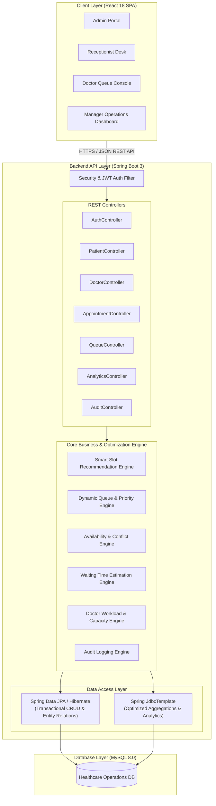

# System Architecture & Technical Design

## 1. High-Level Architectural Overview

The Healthcare Appointment Capacity & Queue Management Platform is designed as a decoupled 3-tier web application built for operational reliability, concurrency safety, and auditability.

---

## 2. Technical Justification: Dual JPA + JDBC Approach

A key architectural design requirement is the deliberate separation of **JPA/Hibernate** and **Spring JDBC Template**:

1. **Spring Data JPA / Hibernate:**
   * Used for standard transactional domain entity mapping (`User`, `Patient`, `Doctor`, `Department`, `Appointment`, `QueueEntry`, `DoctorAvailability`).
   * Enforces object-oriented relationship integrity, dirty checking, validation annotations (`@Valid`, `@NotNull`), and cascade persistence.
   * Handles entity lifecycle and optimistic locking.

2. **Spring JDBC Template:**
   * Used for heavy operational summaries, real-time doctor utilization percentages, historical cancellation trends, and multi-table aggregated analytics queries.
   * Avoids Hibernate object-graph hydration overhead when only aggregate metrics (e.g., `COUNT`, `SUM`, `AVG`, `GROUP BY doctor_id, department_id`) are needed for manager dashboards.
   * Provides predictable query plans and high execution speed for dashboard polling.

---

## 3. Core Engine Components

### 3.1 Smart Slot Recommendation Engine
* **Inputs:** `Doctor ID` (or `Department ID`), `Date`, `Appointment Type ID`.
* **Execution Process:**
  1. Retrieve Doctor's standard availability for the requested day of the week (`start_time`, `end_time`).
  2. Check for Doctor approved leave records on that target date. If on full leave, return 0 slots.
  3. Load scheduled break intervals (e.g., 13:00 - 14:00).
  4. Load existing non-cancelled bookings (`CONFIRMED`, `IN_PROGRESS`, `COMPLETED`) for the target doctor on the target date.
  5. Fetch `appointment_types.duration_minutes` (e.g., 15 mins for follow-up, 30 mins for general consultation, 45 mins for specialist exam).
  6. Generate time intervals across the working window; filter out any slice that collides with breaks, leave, or existing appointments.
  7. Return prioritized, available slot recommendations.

### 3.2 Dynamic Queue & Priority Engine
* **Execution Process:**
  1. For appointments scheduled on the current date, upon patient arrival or scheduled check-in, a `queue_entry` record is activated with an incremental daily `token_number` (e.g., `D1-001`, `D1-002`).
  2. Evaluates the patient's `priority_category` (`EMERGENCY` [weight: 100], `SENIOR_CITIZEN` [weight: 50], `SCHEDULED_STANDARD` [weight: 10], `WALK_IN` [weight: 5]).
  3. Dynamic ordering: Patients currently waiting are ranked by:
     `ORDER BY priority_weight DESC, scheduled_time ASC, token_number ASC`
  4. When a doctor completes a consultation (`COMPLETED`) or marks a patient no-show (`MISSED`), the queue auto-advances.

### 3.3 Waiting Time Estimation Algorithm
* **Formula:**
  $$\text{Estimated Wait Time} = \sum_{i=1}^{N_{\text{ahead}}} \text{Duration}(A_i) - \text{Elapsed Time in Active Consultation}$$
* Displayed on the patient and receptionist console as an **Estimated Wait Time** with transparent indicators of how many patients are ahead.

---

## 4. Role-Based Access Control (RBAC) Matrix

| Feature / Endpoint | ADMIN | RECEPTIONIST | DOCTOR | MANAGER |
| :--- | :---: | :---: | :---: | :---: |
| **Manage Users & Roles** | ✅ | ❌ | ❌ | ❌ |
| **Manage Departments & Doctors** | ✅ | ❌ | ❌ | Read-Only |
| **Configure Doctor Availability & Leave** | ✅ | ✅ | Own Only | Read-Only |
| **Register & Edit Patients** | ✅ | ✅ | Read-Only | Read-Only |
| **Book & Reschedule Appointments** | ✅ | ✅ | ❌ | ❌ |
| **Cancel Appointments** | ✅ | ✅ | ❌ | ❌ |
| **View Daily Queue Console** | ✅ | ✅ | Own Only | Read-Only |
| **Call Next Patient / Complete Visit** | ❌ | ❌ | Own Only | ❌ |
| **Operational Analytics & Utilisation** | ✅ | ❌ | Own Only | ✅ |
| **Audit Logs Viewer** | ✅ | ❌ | ❌ | ✅ |

---

## 5. Security Architecture
* **Stateless Authentication:** Spring Security filter chain with BCrypt password hashing.
* **JWT Token Lifespan:** Secure token exchange with claims carrying user ID, username, and role.
* **Audit Interceptor / AOP:** Method-level logging interceptors capturing mutation actions (`CREATE`, `UPDATE`, `CANCEL`, `RESCHEDULE`, `CALL_PATIENT`) with timestamp and operator identity stored in `audit_logs`.
