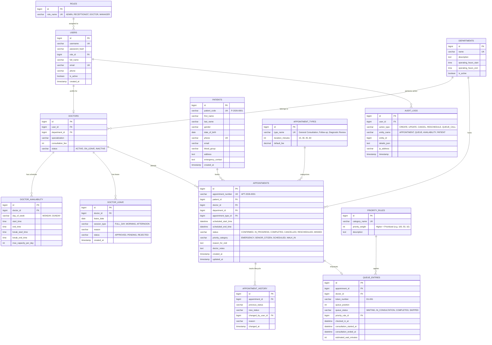

# Database Schema & Data Dictionary

## 1. Entity-Relationship Overview

---

## 2. Table Specifications & Indexes

### Performance & Constraint Indexes
* `appointments`:
  * Index on `(doctor_id, scheduled_start_time, scheduled_end_time, status)` — for rapid smart-slot conflict detection.
  * Index on `(patient_id, status)` — for fast patient history lookups.
  * Index on `(scheduled_start_time, status)` — for daily manager summary aggregations.
* `queue_entries`:
  * Index on `(doctor_id, queue_status, checked_in_at)` — for instant real-time queue ordering.
* `doctor_availability`:
  * Index on `(doctor_id, day_of_week)`.
* `doctor_leave`:
  * Index on `(doctor_id, leave_date, status)`.
* `audit_logs`:
  * Index on `(entity_name, entity_id)` and `(timestamp)`.
