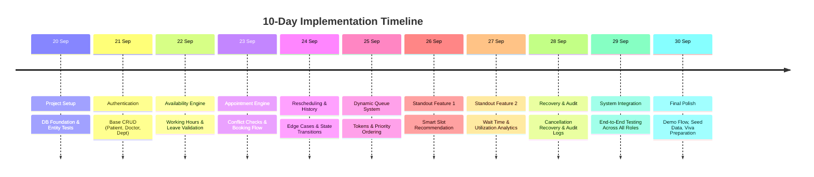

# Implementation Timetable & Daily Milestones

> **Target Delivery Date:** 30 September 2026  
> **Guiding Principle:** Reach a demo-ready, fully integrated version on time. No AI/ML complexity. Core features first, differentiators second, integration & viva preparation at the end.

---

## 📅 Day-by-Day Implementation Roadmap

---

### Day 1 — 20 Sep (Sun): Project Setup + Database Foundation
* [x] Freeze scope, screens, and project specifications.
* [ ] Scaffold Spring Boot 3 backend project with Maven.
* [ ] Scaffold React frontend project.
* [ ] Connect Spring Boot to MySQL 8.0.
* [ ] Execute database DDL migration (`users`, `roles`, `patients`, `departments`, `doctors`).
* [ ] Verify one entity end-to-end via REST endpoint.

---

### Day 2 — 21 Sep (Mon): Authentication + Base CRUD
* [ ] Implement User, Role entities, and Spring Security with BCrypt password hashing.
* [ ] Implement Auth Controller (`POST /api/auth/login`, `GET /api/auth/me`).
* [ ] Implement Patient CRUD (`/api/patients`).
* [ ] Implement Department CRUD (`/api/departments`).
* [ ] Implement Doctor CRUD (`/api/doctors`).
* [ ] Connect React Login screen and basic management views.

---

### Day 3 — 22 Sep (Tue): Availability Management
* [ ] Implement `DoctorAvailability` entity (day of week, start/end time, breaks).
* [ ] Implement `DoctorLeave` entity (dates, reasons, approved status).
* [ ] Build backend validation rules preventing appointments during leave/breaks.
* [ ] Build React doctor availability and schedule management UI.

---

### Day 4 — 23 Sep (Wed): Appointment Engine
* [ ] Create `AppointmentType` (duration in minutes, fee).
* [ ] Implement core Appointment Booking API (`POST /api/appointments`).
* [ ] Validate doctor availability and prevent double bookings.
* [ ] Enforce duration boundaries and break-time exclusions.
* [ ] Implement Appointment Cancellation flow (`PUT /api/appointments/{id}/cancel`).
* [ ] Connect React Booking UI to backend.

---

### Day 5 — 24 Sep (Thu): Rescheduling + History Tracking
* [ ] Implement Rescheduling API (`PUT /api/appointments/{id}/reschedule`).
* [ ] Validate new slot with the same strict rules as new bookings.
* [ ] Create `AppointmentHistory` logging (status changes, previous timestamps, modifier info).
* [ ] Test edge cases: overlapping appointments, leave collisions, invalid slot lengths.

---

### Day 6 — 25 Sep (Fri): Dynamic Queue Management
* [ ] Create `QueueEntry` entity and token generation logic (`D1-001`).
* [ ] Implement Queue status transitions (`WAITING`, `IN_CONSULTATION`, `COMPLETED`, `SKIPPED`).
* [ ] Implement Priority Categories (`EMERGENCY`, `SENIOR_CITIZEN`, `SCHEDULED`, `WALK_IN`).
* [ ] Build Doctor Consultation Console (call next patient, finish visit).
* [ ] Build Receptionist Queue Display.

---

### Day 7 — 26 Sep (Sat): Standout Feature 1 — Smart Slots Recommendation
* [ ] Build Rule-Based Recommended-Slot Service (`GET /api/appointments/recommended-slots`).
* [ ] Algorithm checks availability, breaks, leave, and existing bookings to generate clean slots.
* [ ] Render interactive recommended-slots picker in React.
* [ ] Test across at least 10 booking collision scenarios.

---

### Day 8 — 27 Sep (Sun): Standout Feature 2 — Waiting Time & Doctor Utilisation
* [ ] Implement dynamic waiting time estimator formula based on queue depth and consultation lengths.
* [ ] Implement Doctor Utilization percentage calculation via JDBC Template.
* [ ] Implement Department Workload aggregator query.
* [ ] Build Manager Analytics Dashboard with summary cards and utilization visual charts.

---

### Day 9 — 28 Sep (Mon): Cancellation Recovery & Audit Trail
* [ ] Implement Cancellation Recovery flow (released capacity immediately queryable for new bookings).
* [ ] Implement `AuditLogs` tracking for all critical changes (user, action, timestamp, entity).
* [ ] Build Audit Log viewer UI for Admin / Manager.
* [ ] Test RBAC permission boundaries for all roles.

---

### Day 10 — 29 Sep (Tue): Full System Integration & Testing
* [ ] Connect all React views to live Spring Boot APIs.
* [ ] Execute full end-to-end user journey:
  $$\text{Patient Check-in} \rightarrow \text{Smart Slot Booking} \rightarrow \text{Queue Token} \rightarrow \text{Doctor Consultation} \rightarrow \text{Dashboard Metrics} \rightarrow \text{Audit Log}$$
* [ ] Fix edge case UI/API bugs and validate database constraints.

---

### Day 11 — 30 Sep (Wed): Final Polish & Demo Readiness
* [ ] Feature freeze.
* [ ] Seed database with realistic clinic demonstration data (sample doctors, departments, booked queues).
* [ ] Prepare 5–7 minute walkthrough flow for project viva/demo.
* [ ] Archive and backup source code and SQL dumps.

---

## 🎯 Definition of Done (By 30 September)
A user can log in under any role (`Admin`, `Receptionist`, `Doctor`, `Manager`), register patients, configure doctor working hours and leave, book/cancel/reschedule appointments without double bookings, get smart slot recommendations, generate queue tokens with priority ordering, estimate wait times, view real-time utilization dashboards, and inspect a complete audit trail.
